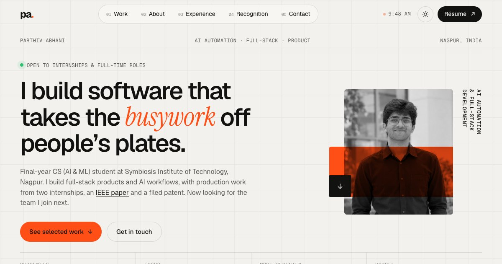

<div align="center">

# Parthiv Abhani · Portfolio

**AI Automation & Full-Stack Developer** · Final-year B.Tech CSE (AI & ML), Symbiosis Institute of Technology, Nagpur

[**Live site ↗**](https://parthiv-abhani-portfolio.vercel.app) &nbsp;·&nbsp;
[Résumé](https://parthiv-abhani-portfolio.vercel.app/assets/Parthiv_Abhani_Resume.pdf) &nbsp;·&nbsp;
[LinkedIn](https://www.linkedin.com/in/parthiv-abhani-b47055231) &nbsp;·&nbsp;
[Email](mailto:parthiv.abhani@gmail.com)

<br />

<a href="https://parthiv-abhani-portfolio.vercel.app">
  
</a>

</div>

---

## About

My personal portfolio: selected projects, experience, research and contact details in a single page. It is built from scratch with plain **HTML, CSS and JavaScript**: no framework, no build step and no runtime dependencies. It's quick to load and simple to host.

## What's inside

| Section | Contents |
|---|---|
| **Hero** | Intro, availability, quick facts (current study, focus, most recent role) |
| **Highlights** | IEEE publication, patent application, hackathon win, top 2% merit scholarship |
| **Selected work** | Waitless, Document Intake Assistant, Cropify, Tieout, Auto Mailer Pro, MoneyMind AI, Kommunity, KnowBit, shown as stacking cards with live screenshots |
| **More work** | MediGist, Mequen Medisystem landing page, WhatsApp Clinic Assistant, EduPredict AI, PlaceIQ |
| **About** | Background and what I'm doing right now |
| **Experience** | Internships and independent work as an expandable timeline |
| **Recognition** | Publication, patent, hackathons, leadership, certifications |
| **Toolbox** | Languages, frameworks, AI and automation tools, platforms |
| **Contact** | Click-to-copy email, LinkedIn, GitHub, résumé |

## Features

- **Motion design:** a loading counter, headings that reveal line by line, project cards that stack as you scroll, a tech-stack marquee that reacts to scroll speed, and stats that count up or scramble into place
- **Interactions:** a custom cursor with context labels, magnetic buttons, a photo tilt on hover, and project screenshots that follow the cursor
- **Light and dark themes:** follows the system setting by default, with a manual toggle that uses a circular View Transition
- **Responsive:** designed for desktop, tablet and phone, with a full-screen mobile menu
- **Accessible:** semantic HTML, visible focus states, keyboard-friendly accordion and menu, and every animation turns off under `prefers-reduced-motion`
- **Performance:** no dependencies, lazy and async image decoding, animation loops that pause when idle or off-screen, and scroll handlers that do all their reads before any writes so the browser never re-runs layout mid-frame
- **SEO and sharing:** meta description, canonical URL, and Open Graph / Twitter cards with a custom preview image

## Tech stack

| | |
|---|---|
| **Markup** | HTML5 |
| **Styling** | CSS (custom properties, grid, sticky positioning, `color-mix`, View Transitions) |
| **Scripting** | Vanilla JavaScript (IntersectionObserver, ResizeObserver, `requestAnimationFrame`) |
| **Fonts** | Geist, Geist Mono and Instrument Serif via Google Fonts |
| **Hosting** | Vercel (static) |

## Project structure

```
parthiv-portfolio/
├── index.html                  # All page content and copy
├── css/
│   └── style.css               # Design tokens (top of file), layout, components, themes
├── js/
│   └── main.js                 # Animations and interactions
└── assets/
    ├── Parthiv_Abhani_Resume.pdf
    ├── me.jpg                  # Hero portrait
    ├── me-casual.jpg           # About section photo
    ├── og.jpg                  # Social share preview (1200×630)
    ├── favicon.svg
    └── work/                   # Project screenshots (1440×900)
```

## Run locally

No install needed. Serve the folder with any static server:

```bash
python3 -m http.server 4321
```

Then open <http://localhost:4321>.

## Deployment

The site is deployed on **Vercel**, connected to this repository. Every push to `main` redeploys it automatically.

To set it up from scratch: import the repo in Vercel, pick the **Other** framework preset, and leave the build command and output directory empty.

## Updating content

| To change | Do this |
|---|---|
| **Résumé** | Replace `assets/Parthiv_Abhani_Resume.pdf`, keeping the same filename so every link still works |
| **Text or copy** | Edit `index.html` |
| **Add a project** | Copy an `<article class="project">` block in `index.html`, set `style="--i:N"` to its position, and add a 1440×900 screenshot to `assets/work/` |
| **Accent colour** | Change `--accent` at the top of `css/style.css` |
| **Share preview** | Replace `assets/og.jpg` (1200×630) |
| **Waitless launch** | Replace "Coming soon to the App Store" in the Waitless card with the App Store link |

## Contact

**Parthiv Abhani** · Nagpur, India
[parthiv.abhani@gmail.com](mailto:parthiv.abhani@gmail.com) · [LinkedIn](https://www.linkedin.com/in/parthiv-abhani-b47055231) · [GitHub](https://github.com/parthivabhani)

---

<sub>© 2026 Parthiv Abhani. The code is open to read and learn from; the personal content (text, photos, résumé and project screenshots) is not licensed for reuse.</sub>
